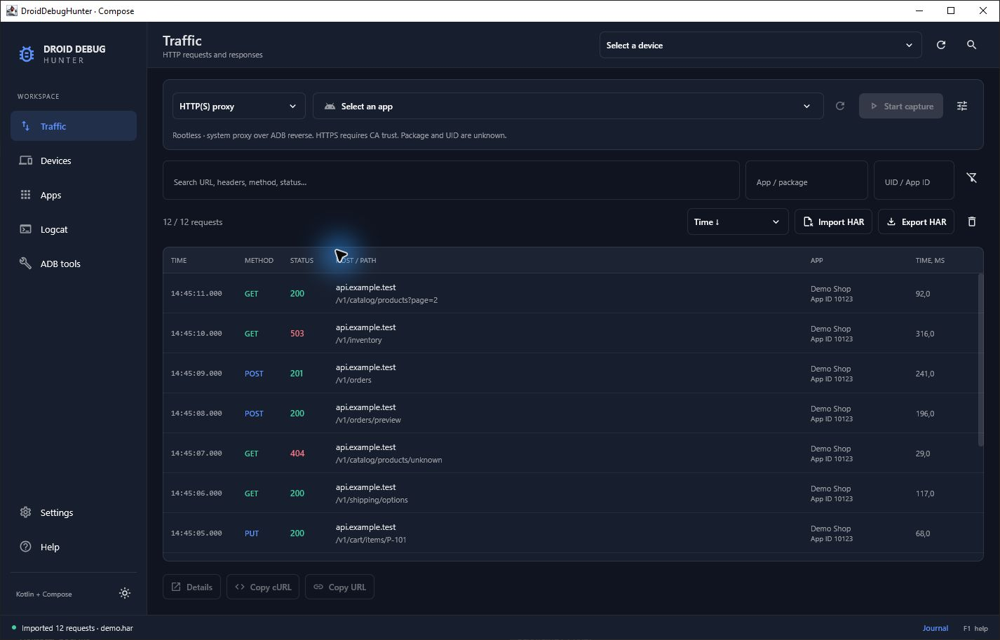
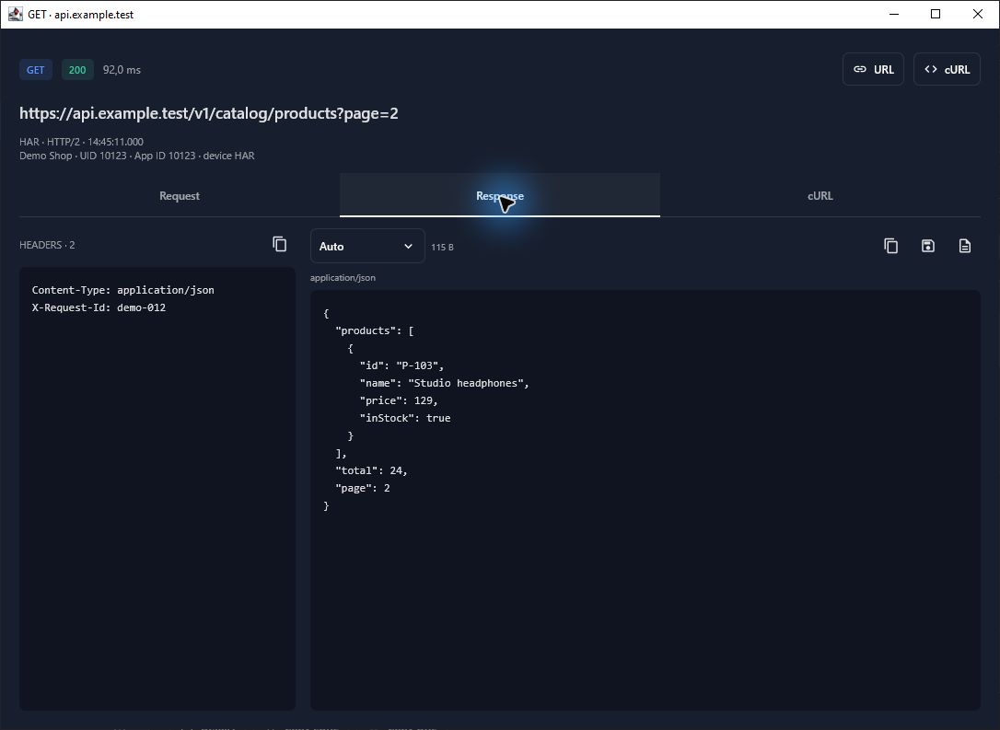
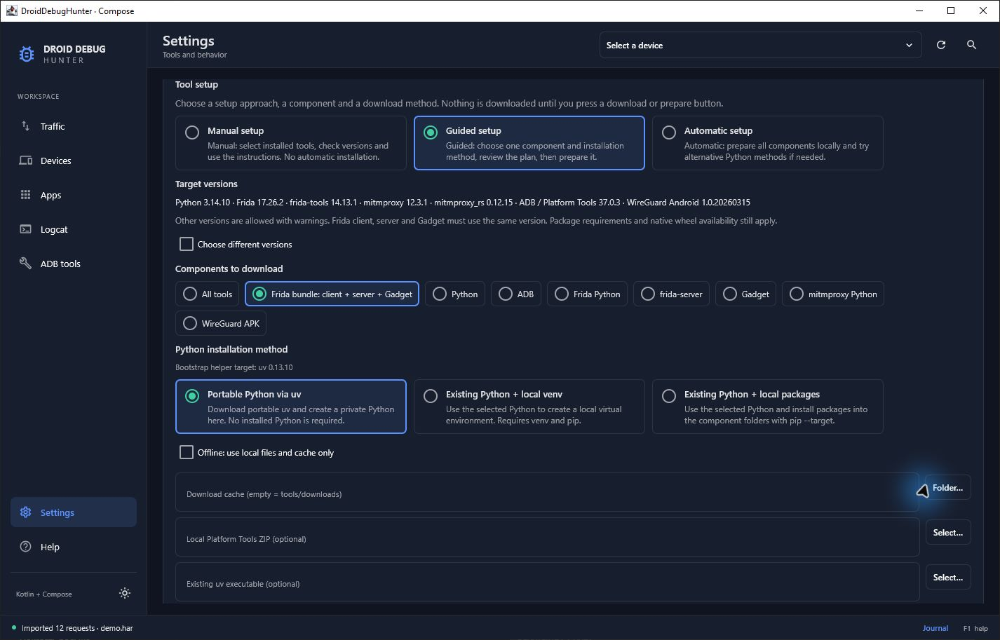
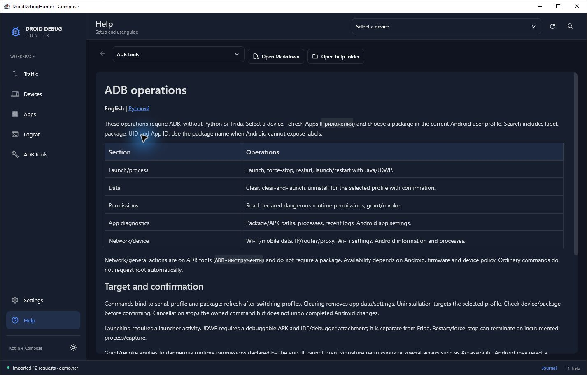

# DroidDebugHunter · Compose

**English** | [Русская документация](README.ru.md)

An Android debugging desktop application built with **Kotlin, Compose Desktop and coroutines**. Manage ADB devices and apps, control Frida, inspect HTTP(S) traffic and stream Logcat on **Windows, macOS and Linux**. This is the Compose port of the [WPF DroidDebugHunter](https://github.com/MaiklGureev/DroidDebugHunter).

[Download a release](https://github.com/MaiklGureev/DroidDebugHunterByCompose/releases) · [Documentation](docs/README.md) · [Android setup](src/main/resources/runtime/help/setup/ANDROID_SETUP_GUIDE.en.md) · [MIT license](LICENSE)

Native distributions include their own Java runtime: **users do not need a system JDK or JRE**. Downloads support Windows x64, Linux x64, and macOS Apple Silicon and Intel. ADB, Python and capture tools are configured separately. The interface supports English and Russian. Switch in Settings → Interface language; the choice is saved automatically and applies immediately, including offline Help. The initial language follows the OS (Russian for ru, English otherwise).

## Screenshots

Windows, dark theme. The traffic and request details use the [synthetic demo HAR](examples/ui-demo.har); no phone or live network capture is involved. Each README shows its own interface language.

[](docs/images/traffic.en.jpg)

<details>
<summary>More screenshots: request details, tool setup and Markdown help</summary>

**Request and response details** — a separate window with headers and formatted JSON.

[](docs/images/request-details.en.jpg)

**Tool setup** — visible setup choices, component bundles, target versions and Python installation methods.

[](docs/images/tool-setup.en.jpg)

**Offline Markdown help** — readable headings, tables and links in the application.

[](docs/images/markdown-help.en.jpg)

</details>

## Features

- USB, emulator and Wi-Fi ADB, Android 11+ pairing, automatic device refresh and remembered selection.
- Apps: names, packages, UID/App ID, user/system groups, Android user profiles, launch/stop/restart, JDWP, package/APK details, runtime permissions, and confirmed data clearing/uninstallation.
- frida-server for four Android ABIs, ELF/version validation, installation, root startup and cleanup of the owned process. Gadget/run-as support for debuggable APKs.
- Four capture modes: HTTP(S) proxy over ADB reverse, Frida OkHttp, Frida Native TLS, and WireGuard VPN. Readiness checks, CA preparation and persistent VPN profiles.
- HAR import **and export** without a phone, request filters/sorting, separate live detail windows, and cURL for PowerShell 7.3+ and sh/bash/zsh.
- Request/response bodies: Auto, Text, JSON, HTML text, Image, HEX and Base64; copy, save captured bytes or export rendered text. Partial bodies are explicitly marked.
- System or app-UID Logcat, buffers/history, Regex/tag/level/PID/TID/UID filters, multiple selection, auto-scroll, and TXT/CSV/JSONL export.
- Android network/device diagnostics, ADB push/pull and APK installation with separate result windows.
- Light/dark themes, command palette, cancellation and an operation journal.

## Run from source

Install **JDK 17**. The Gradle wrapper is included. JDK 21 can run Gradle if toolchain 17 is available. In IntelliJ IDEA, select JDK 17 for the project and Gradle JVM, then run the shared **`desktop`** configuration.

Windows:

```powershell
.\run.ps1
# or
.\run.bat
# With JAVA_HOME configured:
.\gradlew.bat run
```

The launcher selects an installed JDK 17/21 without changing global Java settings. On macOS/Linux:

```sh
./gradlew run
```

The first build needs Maven/Gradle network access. The UI, HAR analysis and unit tests do not require external Android/Python tools.

Gradle's `run` task uses a separate temporary JAR copy, so rebuilding does not replace classes in a running process. Restart to apply source changes. Use `desktop` in IDEA. When running `MainKt` directly, stop it before Rebuild/Clean to avoid `NoClassDefFoundError` for coroutine classes that have not yet been loaded.

## Prepare local tools

Large binaries are **excluded from Git**. Bundles normally live in `desktop-resources/<os>-<arch>/tools/`, such as `windows-x64`, `macos-arm64` or `linux-x64`, or in packaged app resources. You can select another directory and individual ADB/Python executables, including a virtual environment. Detection also checks Android SDK and PATH. Settings keep separate paths for each OS/CPU.

On **Connection**, each tool shows its status, folder and options. Use **Manual download** for links and placement instructions or **Download and prepare** to let the app fetch the tool. The wizard supports portable Python via uv without a system interpreter or administrator elevation, existing Python/venv, local archives and offline wheelhouses. Downloads show progress and a live log, with cancellation. Components can be prepared separately or as a Frida bundle; individual archives/APKs can be downloaded without installation. Versioned links can be copied, and placement/cache folders opened. Missing directories are created on startup when writable; the guide includes the complete manual folder layout. Other versions are allowed with warnings; see the [version matrix and setup guide](src/main/resources/runtime/help/setup/DOWNLOADS.en.md).

Prepare tools from the CLI on the **target OS/CPU**, using an existing Python **3.11+** (target **3.14.10**, proxy **3.12+**) (`python` on Windows, `python3` on macOS/Linux):

```sh
python3 prepare-tools.py --action init
python3 prepare-tools.py --action download --component all
python3 prepare-tools.py --action check
```

Windows also provides a wrapper:

```powershell
.\prepare-tools.ps1 -Action init
.\prepare-tools.ps1 -Action download -Component all -Python python
.\prepare-tools.ps1 -Action check
# Reuse an existing Windows bundle:
.\prepare-tools.ps1 -Source 'D:\FridaDebugTool' -Action check
```

`-CopyPython` copies a full installed 64-bit Python 3.11+ interpreter. Target versions are in `tool-versions.json`; target Python 3.14 dependencies are frozen in the requirements files. Custom versions/interpreters use package metadata for resolution. Frida client/server/Gadget must match each other; the target is **17.26.2**.

The same checks/preparation are available in **Connection**. Normal startup downloads nothing. Settings, traffic, CA certificates and VPN keys are not imported from the old project. See [platform configuration](docs/PLATFORMS.md) and [tool preparation](src/main/resources/runtime/help/setup/DOWNLOADS.en.md).

## Connect a phone

1. Open **Connection** and choose USB, Wi-Fi, or Emulator. Select the Android device.
2. On **Connection**, choose a capture method and complete its setup. For Frida or WireGuard, select the target app on **Traffic** first.
3. Run the readiness checks and complete any prompts on Android. On **Traffic**, select **Start capture**.

A regular proxy cannot identify the package/UID. VPN attribution comes from its configured allowlist. HTTPS proxy/VPN capture requires the target app to trust the CA. Pinning, unavailable TLS functions and HTTP/3 can limit capture. Rootless Frida requires a debuggable APK with working `run-as`/JDWP.

See the [user guide](src/main/resources/runtime/help/guides/USAGE.en.md) and [Android setup](src/main/resources/runtime/help/setup/ANDROID_SETUP_GUIDE.en.md). Help works offline; HAR analysis is available without Android.

## Markdown help

Help renders headings, lists, tables, inline formatting and fenced code with selectable text. Use **Open Markdown** to read a local `.md`/`.markdown` file. Links navigate within the document directory; Back returns to the previous page. HTTP(S) links open in the system browser when clicked. Code blocks have a Copy code button.

Dependency and plugin versions are centralized in [`gradle/libs.versions.toml`](gradle/libs.versions.toml). Compose selects host-specific desktop natives through `currentOs`.

## Keyboard shortcuts

| Action | Shortcut |
| --- | --- |
| Import HAR | Ctrl+O |
| Command palette | Ctrl+K |
| Help | F1 |
| Request/log details | Enter or double-click |
| Multiple log rows | Ctrl/Shift + click |
| Copy selected Logcat rows | Ctrl+C |
| Close detail/result window | Esc |

macOS also supports ⌘ for platform shortcuts.

## Sessions and storage

Navigation preserves capture. Changing/losing a device stops its streams. Normal shutdown cancels owned operations/processes, restores the previous proxy and removes owned ADB forwards/reverses. It **does not stop the shared ADB server**. After a disconnect or forced termination, Android settings may need manual restoration.

Settings, CA and VPN keys are stored in `%LOCALAPPDATA%\DroidDebugHunterCompose` on Windows, `~/Library/Application Support/DroidDebugHunterCompose` on macOS, or `$XDG_DATA_HOME/DroidDebugHunterCompose` / `~/.local/share/DroidDebugHunterCompose` on Linux. Resetting CA/VPN makes a backup. Installed certificates and imported profiles are not automatically removed from Android. WireGuard Remote control is required for automatic tunnel shutdown by broadcast.

Record limits are supplemented by approximate memory budgets of 96 MiB for HTTP and 64 MiB for Logcat. Evictions and overload drops are counted. RE2/J provides linear-time regex filtering without lookbehind/backreferences.

## Test and package

```sh
./gradlew test createDistributable
python3 -m unittest discover -s scripts -p 'test_*.py'
```

Windows also supports `.\run.ps1 -Task test` and `.\run.ps1 -Task createDistributable`. Native output is under `build/compose/binaries-1.1.3/main/app/`. Copy the complete app directory, including its runtime. Build installers on their target OS with `packageMsi`, `packageDmg` or `packageDeb`. The Compose plugin prepares WiX for MSI; its first download needs GitHub access.

Check the Windows launcher without system Java:

```powershell
.\scripts\smoke_windows.ps1 -ApplicationRoot .\build\compose\binaries-1.1.3\main\app\DroidDebugHunterByCompose
```

On macOS/Linux, use `python3 scripts/package_release.py --runtime-check`. These checks exercise private Java, device selection and model shutdown using temporary data without connecting to Android.

Tests cover HAR/binary/partial bodies, cURL, platform profiles, tool discovery, ADB/UID/permissions, Logcat, process timeouts and cancellation. CI builds all three OS families, including Intel and Apple Silicon release packages. Full Frida/VPN scenarios need a compatible Android test app. A local proxy integration test runs if the optional tools bundle is available; otherwise it is skipped. Rebuild the Android DEX helper with `python scripts/build_app_labels.py --sdk <Android-SDK> --java-home <JDK>`.

## Contribute and license

See [Contributing](CONTRIBUTING.md), [Security](SECURITY.md), [Architecture](docs/ARCHITECTURE.md), and [Release process](docs/RELEASING.md).

The project's own code is licensed under the [MIT License](LICENSE). Third-party components retain their own licenses and notices; see [Third-party notices](THIRD_PARTY_NOTICES.md). Downloaded tool bundles are not committed to this repository.
